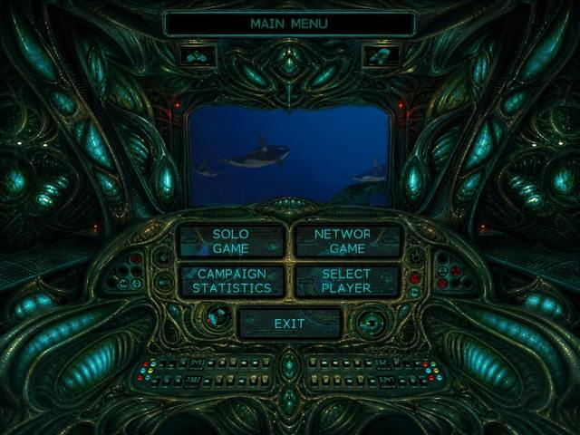
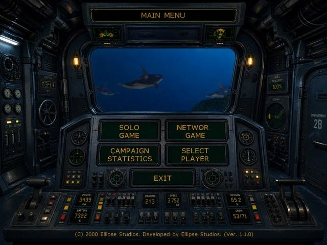
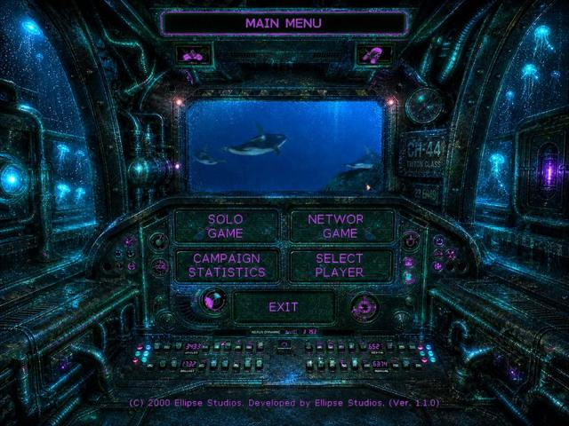
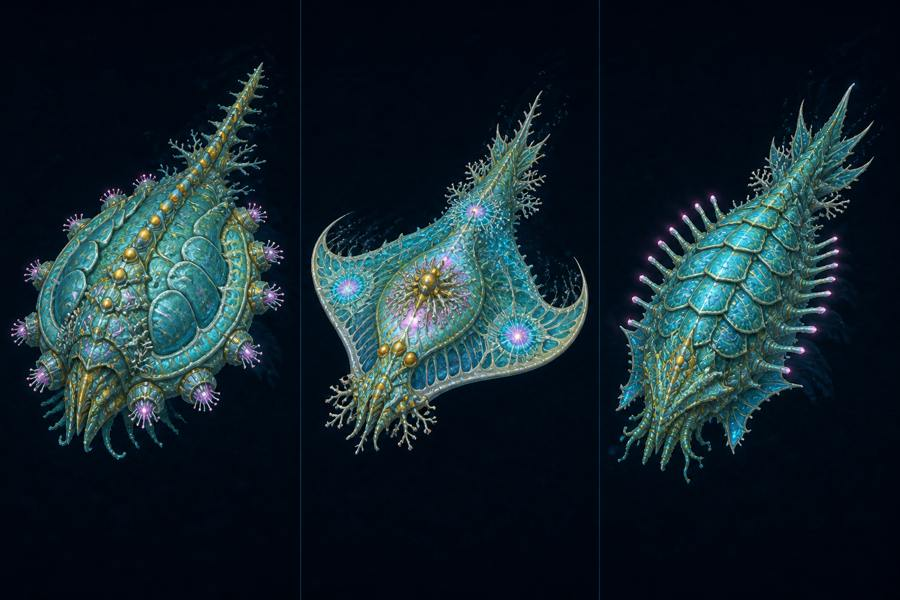

# Submarine titan Burebista mod

**Mod visual para Submarine Titans · Paquete principal v9**

[Descargar / Download](https://github.com/florynstefanache-source/Submarine-titan-Burebista-mod/releases/latest) · [English](#english)

## Español

Una interfaz submarina renovada: cabinas con personalidad propia, instrumentos tácticos y paneles que acompañan la partida. Esta página documenta los archivos y las guías incluidos en el paquete de Burebista.

### Mejoras del paquete principal v9

- HUD táctico con profundidad, sonar y reloj.
- Paneles inferiores de navegación y estado del submarino.
- Barra lateral de grupos numéricos y submarino animado al pasar el cursor sobre ella.
- Dos torretas laterales que siguen la posición del cursor como elemento visual.
- Tres cabinas aleatorias de menú: **Silicon biomecánica**, **militar humana** y **abisal fluorescente**.
- La guía v9 indica que conserva el cursor original en menús, campaña y escaramuzas, y el aspecto original de la selección de mapas.
- Configuración incluida con resolución nativa, desplazamiento suave, limitador de FPS mejorado y corrección de memoria de vídeos.

El paquete v9 **no incluye el mod de yacimientos** y no modifica `OBJECT.DKD` ni `OBJECT.DKX`. El instalador sí restaura los archivos de interfaz `inter.DKD` y `inter.DKX` incluidos en v9.

### Imágenes de las cabinas incluidas

Estas imágenes proceden de los recursos de menú del mod; no son capturas nuevas de una partida.

**Silicon biomecánica**

**Militar humana**

**Abisal fluorescente**

### Conceptos visuales adicionales

Leviatán Caparazón, Manta de Núcleo y Titán Trilobite. Son **propuestas artísticas incluidas en el archivo**, no unidades nuevas cuya implementación esté acreditada por el paquete v9.

### Instalación del mod principal

1. Instala Submarine Titans y ejecútalo una vez desde Steam. Cierra el juego.
2. Descarga **Submarine_Titans_MOD_LIMPIO_CURSOR_ORIGINAL_v9.zip** desde Releases. También está dentro del RAR completo.
3. Extrae **todo** el ZIP a una carpeta; conserva `MenuCabins` y `system`.
4. La ruta que espera el instalador es:
   `C:\Program Files (x86)\Steam\steamapps\common\Submarine Titans`
   Si tu biblioteca está en otra ubicación, edita la variable `set "game=..."` de `INSTALAR_MOD_DEFINITIVO.cmd` para señalar la carpeta que contiene `ST.exe`.
5. Ejecuta `INSTALAR_MOD_DEFINITIVO.cmd` como administrador.
6. Abre el juego desde Steam.

El instalador copia las DLL, la configuración, las tres cabinas y los archivos de interfaz. Guarda las versiones anteriores de `subtitans.dll`, `subtitans.ini`, `inter.DKD` e `inter.DKX`, cuando existen, en **MOD_DEFINITIVO_BACKUP**; no sobrescribe una copia previa. Esa carpeta no constituye una copia completa del juego. También elimina los recursos antiguos `SonarSpear.ani` y `SonarSpear.rgba`, si existen.

### Extras del RAR completo

| Contenido | Qué incluye |
|---|---|
| Paquete v9 | Mod principal e instalador descritos arriba. |
| MEJORA SILICON ELITE FUNCIONAL.zip | Guía opcional para activar tecnologías nativas con el comando `TECH`. |
| subtitansmaps.zip | Nueve paquetes de mapas adicionales. |
| SubTitans-2026-06-07_09-21-17.zip | Paquete separado del parche de compatibilidad SubTitans, con su documentación y licencia. |
| Imágenes y vídeo | Conceptos Silicon, fondos de pantalla y `submarine.mp4`. |
| Archivo .reg | Ajuste de un identificador de versión del registro; por sí solo no instala el parche 1.1. |

Mapas incluidos: Third Circle, Quiet Lagoon, Still Waters, Corium Rush, Deep Maze, Grand Fairway, Ocean Warfare, Combat Zone y Deadly Encounters. Son extras separados del instalador v9.

La guía Silicon Elite indica: inicia una partida Silicon, pulsa Enter, escribe **TECH** y vuelve a pulsar Enter. Debe repetirse en cada partida nueva. Describe mejoras nativas de blindaje, regeneración y Energy Shell; no es un sistema nuevo de experiencia o veteranos.

El RAR también contiene un instalador de grabador de pantalla ajeno al mod. **No se necesita para instalar o jugar**. Para instalar únicamente el mod, usa el ZIP v9.

### Compatibilidad y ayuda

La documentación del parche SubTitans incluido señala compatibilidad con Retail/GOG 1.1 y soporte limitado para 1.0/demos. El instalador de Burebista está preparado específicamente para la ruta Steam indicada. No se han ejecutado el juego ni el instalador como parte de esta publicación.

- Si falla la entrada, la documentación de SubTitans propone probar `CustomInput=false` en `subtitans.ini`.
- Conserva juntos los archivos de v9; el RAR contiene otras versiones de DLL que no deben mezclarse a ciegas con el paquete principal.
- La configuración v9 conserva `SonarSpearCursor=true`, aunque su LEEME describe el cursor original. Se documenta esta diferencia sin alterar los archivos distribuidos.
- Para volver atrás, cierra el juego y restaura los archivos respaldados en sus ubicaciones originales. Para los archivos sin respaldo, utiliza una copia propia o la verificación de archivos de Steam.

### Créditos

Mod y recopilación: **Burebista**. Juego original: **Submarine Titans**.
Parche de compatibilidad: [SubTitans — UnknownException](https://github.com/UnknownException/SubTitans), Copyright © 2020 Max Visser, licencia MIT. Véase [licencia incluida](licenses/SubTitans-MIT.txt).
La licencia del parche no concede derechos sobre el juego ni sobre todos los recursos de esta recopilación.

## English

**A visual mod for Submarine Titans — main package v9.**

### Features

- Tactical HUD with depth, sonar and clock.
- Bottom navigation and submarine status panels.
- Numbered control-group rail with an animated submarine on hover.
- Two decorative side turrets tracking the cursor.
- Three randomized menu cabins: biomechanical Silicon, human military and fluorescent abyssal.
- The v9 guide describes the original cursor and original skirmish map-selection appearance.
- Included settings enable native resolution, smooth scrolling, an improved FPS limiter and a movie-memory fix.

The three cabin images above are previews exported from the supplied menu resources. The Silicon ship artwork is **concept art**, not evidence of newly implemented playable units.

v9 does **not** include the resource-deposit mod and leaves `OBJECT.DKD/DKX` unchanged. It replaces the interface `inter.DKD/DKX` files with the copies supplied in v9.

### Installation

1. Install Submarine Titans, launch it once through Steam, then close it.
2. Download **Submarine_Titans_MOD_LIMPIO_CURSOR_ORIGINAL_v9.zip** from [Releases](https://github.com/florynstefanache-source/Submarine-titan-Burebista-mod/releases/latest), or extract that ZIP from the full RAR.
3. Extract the entire ZIP, keeping the `MenuCabins` and `system` folders.
4. The installer expects `C:\Program Files (x86)\Steam\steamapps\common\Submarine Titans`. For another location, edit its `set "game=..."` line to point to the folder containing `ST.exe`.
5. Run `INSTALAR_MOD_DEFINITIVO.cmd` as administrator, then launch through Steam.

Existing DLL/configuration and interface files are backed up in **MOD_DEFINITIVO_BACKUP**, if present and not already backed up. This is a partial backup, not a full game backup. Old SonarSpear cursor resources are removed if present.

### Optional content and notes

The full original RAR also contains nine map archives, a separate SubTitans compatibility package, wallpapers, concept images, a video and a Silicon Elite guide. Silicon Elite uses the game's native **TECH** command: Enter → TECH → Enter in a Silicon match; repeat for each new match. It is not a new experience/veterancy system.

The included registry file only changes a version identifier; it does not install patch 1.1. The unrelated screen-recorder installer is not required. Use the standalone v9 ZIP for the main installation.

The bundled SubTitans documentation lists Retail/GOG 1.1 support and limited 1.0/demo support. Burebista's installer targets the Steam location above. This publication was inspected from files, without running the game or installer.

Do not mix the other DLL versions in the RAR with v9 without checking compatibility. The v9 INI retains `SonarSpearCursor=true` despite its guide describing the original cursor; the uploaded files are unchanged. For input problems, the SubTitans guide suggests `CustomInput=false`. To uninstall, restore backed-up files and recover files without backups from your own copy or Steam verification.

**Credits:** Burebista (mod/package); Submarine Titans (original game); [SubTitans / UnknownException](https://github.com/UnknownException/SubTitans), © 2020 Max Visser, MIT. See [license](licenses/SubTitans-MIT.txt). This license applies to that patch, not automatically to the entire collection.
